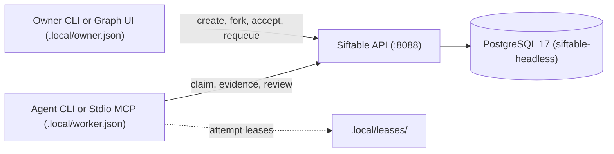

# Siftable

Siftable is a local, PostgreSQL-backed context and work-graph service for accountable coding agents. It pairs a headless HTTP API, CLI, and stdio MCP server with a local dependency-DAG UI so agents share durable notes, claim bounded tasks, and submit evidence while human operators retain final acceptance—with no cloud accounts, browser logins, or model keys.

[Quickstart](#quickstart) · [How it works](#how-it-works) · [Graph UI & Antigravity](#graph-ui--antigravity) · [Modules](#modules) · [MCP](#mcp) · [Backup](#backup-and-validation) · [Docs](#docs)

## What you get

- **Dependency-ordered work DAGs**: Inspect ready frontiers and transitive unblocks with `work.graph`, or split a task into 1–25 gated child branches atomically with `work.fork`.
- **Attempt-scoped leases and idempotency**: Every claim creates an epoch-tracked lease secret under `.local/`, and every mutation requires a stable request key for safe retries.
- **Evidence separated from acceptance**: Agents submit `work.evidence` and request `work.review`, while `work.accept` and other operator actions require `.local/owner.json`.
- **Versioned context and custom schemas**: Store notes with revision history, immutable context packets, and custom object/relation schemas validated against a bounded JSON Schema subset.
- **Verified PostgreSQL 17 snapshots**: `admin backup`, `backup-verify`, and `restore` produce `pg_dump` custom archives with per-table SHA-256 manifests and restore only into a fresh database.

## How it works

Choose the workflow that fits what you are doing:

| Workflow | Best for | Entry point |
|---|---|---|
| Verify end-to-end locally | Confirming setup, CLI, stdio MCP, and non-self-acceptance | `npm run example:first-work` |
| CLI | Scripted setup, inspection, and owner operations | `npm run sift -- <op> --config .local/owner.json` |
| Stdio MCP + Antigravity | Scoped agent execution with `siftable-dag` and sidecar | `npm run plugin:install` + `packages/mcp/dist/index.js` |
| Local Graph UI | Reviewing the DAG, `Next` queue, forks, and handbacks | `npm run ui` (`http://127.0.0.1:7041`) |

Owner credentials (`.local/owner.json`) control instance administration, work creation, and human acceptance. Agent credentials (`.local/worker.json`) are scoped to reading context, holding claims, and submitting evidence for review:



```text
work.create -> work.claim -> work.start -> work.evidence -> work.review -> owner: work.accept
                    |
                    +-> work.fork (splits into 1-25 gated child branches; parent waits)
```

## Quickstart

Prerequisites: **Node.js >= 22** (with `npm`; `22.23.3` is the tested container runtime), a running **Docker Engine**, and the **Docker Compose v2+** plugin accessible without `sudo`.

Run setup from the repository root without `sudo`:

```sh
npm ci
npm run build
npm run local
npm run example:first-work
```

`npm run local` starts PostgreSQL 17 and the server on `http://127.0.0.1:8088`, writing random database credentials and `.local/owner.json` with private permissions. `npm run example:first-work` ([scripts/first-work.mjs](scripts/first-work.mjs)) runs a full CLI-and-MCP check: it creates a project, note, and work item via CLI, mints a temporary agent credential, claims work, launches a real stdio MCP client to build context and submit evidence, confirms request-key replay and that the agent is refused `work.accept` on both CLI and MCP, records owner acceptance, and revokes the temporary credential (saving IDs to `.local/first-work.json`).

> [!IMPORTANT]
> Keep `.local/` private and paired with its database. Do not commit it, paste credential file contents, delete `.local/`, or run `docker compose down -v` as troubleshooting. To use a port other than `8088`, export `SIFT_PORT` **before** the first `npm run local`. See [docs/OPERATIONS.md](docs/OPERATIONS.md) for custom ports, selective module installs, and troubleshooting.

## Graph UI & Antigravity

Start the local Graph UI (`@siftable/graph-ui`) after building:

```sh
npm run ui
```

The UI listens on `http://127.0.0.1:7041` (override with `SIFT_UI_PORT` or `ANTIGRAVITY_SIDECAR_WEB_PORT`). It connects live using `SIFT_CONFIG` or `.local/owner.json`, or falls back automatically to interactive demo mode (`SIFT_UI_DEMO=1` or when unconfigured) so you can inspect the interface without Docker running. Features include a pan/zoom DAG canvas with an orange active frontier, a priority-ordered `Next` queue, inline `+ Fork branches`, handback artifact inspection, and human `Accept` or `Reopen / Requeue` controls.

Install the global Antigravity plugin (`~/.gemini/config/plugins/siftable-graph`, override with `-- --target <dir>`):

```sh
npm run plugin:install
```

This configures the auxiliary-pane Graph sidecar (`owner.json`, or demo mode until created), installs the `siftable-dag` skill and `AGENTS.md` rules, and writes `mcp_config.json` wired to `.local/worker.json` once minted (skipped until `worker.json` exists unless you pass `-- --allow-owner-mcp`).

## Modules

Siftable exposes **63 registry operations** across **6 modules** (`packages/contracts/src/index.ts`):

| Module | Ops | Requires | Scope |
|---|---|---|---|
| `foundation` | 3 | Always installed | Credentials, scopes, module ledger, schema inspect, audit, idempotency |
| `projects` | 6 | `foundation` | Project CRUD, instructions, tombstone delete and restore |
| `context` | 10 | `foundation` | Note CRUD, search, revision history, immutable context packets |
| `work` | 25 | `foundation` | Work CRUD, `work.graph`, `work.fork`, leases, evidence, artifacts, review/accept |
| `planning` | 6 | `projects` | Human task CRUD, completion/cancellation, acceptance criteria |
| `extensions` | 13 | `foundation` | Versioned custom object schemas, validated records, typed relations |

Inspect available operations and parameter schemas directly from the CLI:

```sh
npm run sift -- catalog --config .local/owner.json
npm run sift -- work.graph --help
npm run sift -- work.fork --help
```

`--help` renders syntax offline from the bundled registry; `catalog` queries the running server for enabled modules and credential permissions.

## MCP

Mint a scoped agent credential using `ownerId` from `config.info` without printing secrets:

```sh
OWNER_ID=$(node packages/cli/dist/index.js config.info --config .local/owner.json | node -pe 'JSON.parse(require("fs").readFileSync(0,"utf8")).ownerId')

docker compose run --rm admin credential \
  --owner-id "$OWNER_ID" --role agent \
  --permissions foundation:read,projects:read,context:read,context:write,work:read,work:write \
  --output /run/sift/worker.json --url "http://127.0.0.1:${SIFT_PORT:-8088}"
```

Point any stdio MCP client at the built server using absolute paths:

```json
{
  "mcpServers": {
    "siftable": {
      "command": "node",
      "args": ["/absolute/path/to/siftable/packages/mcp/dist/index.js"],
      "env": {
        "SIFT_CONFIG": "/absolute/path/to/siftable/.local/worker.json",
        "SIFT_TOOLS": "projects,context,work"
      }
    }
  }
}
```

`SIFT_TOOLS` filters tool presentation (`work_claim`, `notes_get`, etc.) and never grants permissions. Use the same credential path across CLI and MCP when continuing a claim so both read the same `.local/leases/` custody files.

## Backup and validation

Create, verify, and restore PostgreSQL 17 backups:

```sh
docker compose run --rm admin backup --output /run/sift/backup-001
docker compose run --rm admin backup-verify --file /run/sift/backup-001
docker compose run --rm admin restore --file /run/sift/backup-001 --database siftable_recovered
```

Restore targets a **fresh database only**, clears active leases, and restores snapshot revocation state—reapply any post-backup credential revocations before serving the recovered database (see [docs/BACKUP_AND_RECOVERY.md](docs/BACKUP_AND_RECOVERY.md)).

Run unit, type, formatting, isolated integration, and clean-environment README checks, or stop and resume the Compose stack without losing data:

```sh
npm test
npm run typecheck
npm run format:check
npm run test:isolated
npm run test:readme
```

```sh
docker compose stop
docker compose start
```

`npm run test:readme` archives **committed `HEAD`** into a clean Linux Docker-in-Docker environment and verifies setup, CLI/MCP flow, stop/start, and backup/restore automatically (not unaided human UX or every host OS). See [docs/OPERATIONS.md](docs/OPERATIONS.md) for harness details, `EACCES` ownership checks, and operational procedures.

## Scope and limits

- **Local extraction, private packages**: All workspace packages are `"private": true` and unpublished on npm. Source is licensed under [Apache-2.0](LICENSE).
- **API role separation, not OS sandboxing**: `.local/worker.json` cannot self-accept work, but credentials do not isolate processes running as the same OS user. Compose `server` binds `127.0.0.1:${SIFT_PORT:-8088}` under fixed project name `siftable-headless` (one install per Docker daemon) and is not an outbound firewall.
- **Submitter-asserted evidence**: `work.evidence` records the submitter's statement and provenance; Siftable does not execute submitted commands or treat `commands_passed` as human acceptance.
- **Bounded formats and transport**: Stdio MCP only (no HTTP MCP or MCP Apps). `work.artifacts.add` stores bounded text up to `64,000` characters with no binary or object-store attachments.
- **Non-destructive tombstones and immutable definitions**: `*.delete` tombstones records without reclaiming storage; `modules.set` disables only unreferenced modules; schema and relation definitions are immutable and support optional-property upgrades only.
- **Out of scope**: Managed agent execution or launching, code-memory module, collaboration mailbox, calendar/CRM, repo checkout mapping, portable record interchange, and hosted-client compatibility promises.

### Docs

- [docs/OPERATIONS.md](docs/OPERATIONS.md) — module migrations, `work.lease` epoch custody, tombstones, custom schema rules, custom ports, and troubleshooting
- [docs/BACKUP_AND_RECOVERY.md](docs/BACKUP_AND_RECOVERY.md) — snapshot manifest model, database URL switching, and quarantine recovery
- [docs/extraction-plan.md](docs/extraction-plan.md) — full local extraction proposal
- [docs/WORK.md](docs/WORK.md) — implemented scope, tests, and compatibility notes
- [docs/PROVENANCE.md](docs/PROVENANCE.md) — source provenance and adapted contracts
